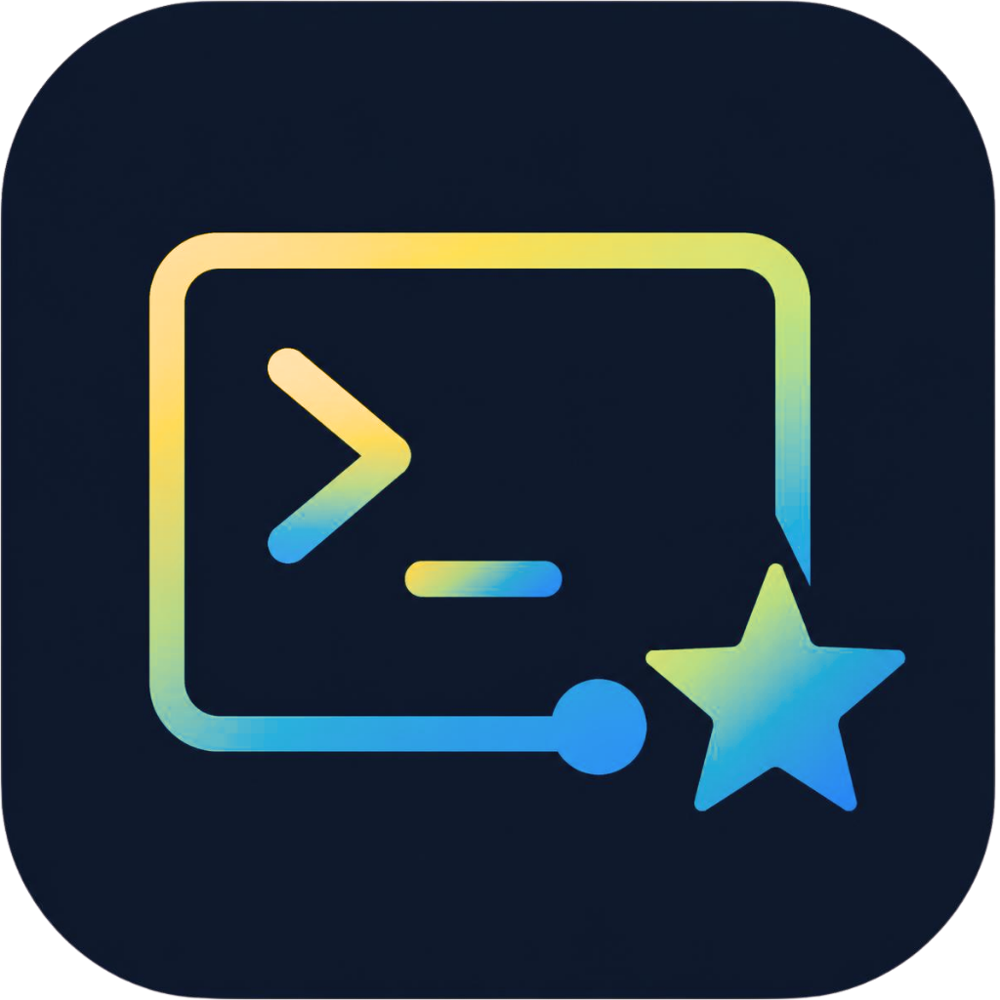
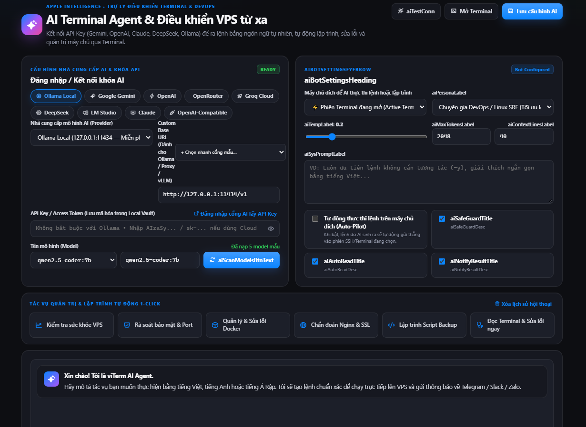
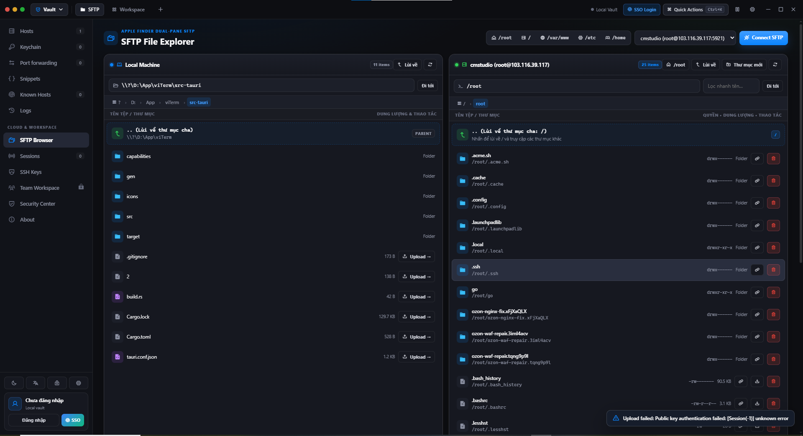

  
  <h1>viTerm — Apple-Crafted SSH, SFTP & AI Terminal Workspace</h1>
  
<strong>Trình quản trị máy chủ SSH, Dual-Pane SFTP kéo thả, Chia khung 2×2 Split View & Trợ lý AI DevOps thế hệ mới</strong>

  

    
    
    
    
  

  

    <a href="#-tính-năng-nổi-bật">Tính năng</a> •
    <a href="#-ai-terminal-agent--bot-devops">AI Terminal Agent</a> •
    <a href="#-dual-pane-sftp--live-code-editor">SFTP Studio</a> •
    <a href="#-kiến-trúc-bảo-mật-zero-trust">Bảo mật</a> •
    <a href="#-tải-xuống--cài-đặt">Tải xuống</a> •
    <a href="#-english-overview">English</a>
  

---

## 🌟 Giới thiệu tổng quan

**viTerm** là không gian làm việc hạ tầng đám mây (SSH, SFTP, Port Forwarding, Keychain & AI DevOps Copilot) được thiết kế tối giản theo chuẩn **Apple Human Interface Guidelines (macOS Sequoia Dark & Apple Keynote Light)**.

> **Lưu ý về Kho lưu trữ (Official Public Showcase Repository)**:
> Đây là kho lưu trữ giới thiệu sản phẩm, tài liệu hướng dẫn, theo dõi lỗi (Issues) và phát hành bản cài đặt chính thức (`.msi` / `.exe` / `.dmg` / `.AppImage`) của **viTerm**. Mã nguồn lõi và cấu hình máy chủ nội bộ được lưu riêng; repo này dùng cho tài liệu, Issues và bản phát hành.

---

## ✨ Tính năng nổi bật

### 1. 🖥 Terminal Chia khung 2×2 (`Split View`) & 10 Chủ đề Giao diện
- **Chia khung linh hoạt (`1×1`, `1×2`, `2×2 Quad Grid`)**: Mở đồng thời tối đa 4 phiên SSH hoặc Local Shell (PowerShell / Bash) trên cùng một màn hình với tốc độ kết xuất 60fps.
- **Broadcast Input (`Gõ 1 khung — Thực thi đồng loạt`)**: Gửi lệnh cùng lúc tới toàn bộ dàn máy chủ trong nhóm chỉ với 1 lần gõ phím.
- **Tự động phát hiện Link thông minh (`Ctrl + Click chuột trái`)**: Tự động gạch chân mọi URL/IP trong Terminal kèm menu mở nhanh trên trình duyệt mặc định hoặc cửa sổ Popup nội bộ.
- **Ghi nhớ thao tác Chuột phải thông minh**: Tùy chọn tự động *Có bôi đen → Copy, Không → Dán* hoặc *Dán ngay lập tức* và ghi nhớ vĩnh viễn cho các lần sau.
- **Apple Command Palette (`Ctrl + K`)**: Tìm kiếm và kết nối tức thì tới bất kỳ máy chủ, công cụ hoặc câu lệnh nào.

### 2. 🤖 AI Terminal Agent & Điều khiển VPS từ xa
- **9 Cổng API mẫu 1-Click & Tương thích hoàn toàn `OpenAI-Compatible`**:
  - Hỗ trợ **Ollama Local** (chạy miễn phí trên máy không cần API Key), **Google Gemini**, **OpenAI**, **OpenRouter**, **Groq Cloud LPU**, **DeepSeek (V3/R1)**, **LM Studio**, **vLLM / LocalAI / Jan.ai**, và **Anthropic Claude**.
- **Tự động Quét Model (`1-Click Auto Model Scanner`)**: Tự động truy vấn danh sách model trực tiếp từ cổng API để chọn ngay mà không cần gõ tay.
- **Chế độ Auto-Pilot & Safe-Guard**:
  - Tự động đọc ngữ cảnh lỗi trên màn hình Terminal để chẩn đoán và sinh lệnh sửa lỗi.
  - Bộ lọc **Safe-Guard** tự động chặn và yêu cầu xác nhận trước khi thực thi các lệnh nhạy cảm (`rm -rf`, `mkfs`, `reboot`).

### 3. 📂 Apple Finder Pro Dual-Pane SFTP & Live Code Editor
- **Khởi đầu trực tiếp tại `/root` & Thanh đường dẫn Breadcrumb**: Điều hướng phân cấp `[ / ] › [ var ] › [ www ]` và lối tắt 1-Click (`/root`, `/`, `/var/www`, `/etc`, `/home`).
- **Kéo & Thả 2 chiều (`Drag & Drop`) + Upload File lớn có Thanh tiến trình (`Progress Bar`)**:
  - Kéo tệp từ khung Local thả sang khung Remote (hoặc kéo trực tiếp từ Windows Explorer) để tải lên theo luồng kèm thanh phần trăm tiến độ trực quan.
  - Kéo tệp từ khung Remote thả sang khung Local để tải về máy.
- **Trình sửa Code trực tiếp (`Live Code Editor`) với `Auto-Save`**:
  - Nhấn đúp vào tệp trên Server để mở trình soạn thảo có đánh số dòng, hỗ trợ `Ctrl + S` và **Tự động Lưu & Upload** ngay khi ngừng gõ, đồng thời tự động dọn sạch bản tạm cũ trên máy cục bộ.
- **Giải nén 1-Click & Đổi tên trực tiếp**: Giải nén `.zip`, `.tar.gz`, `.tgz`, `.tar`, `.bz2`, `.xz`, `.gz` ngay trên Server.

### 4. 🔔 Trung tâm Thông báo Đa kênh (`Telegram`, `Zalo Bot`, `Slack`, `Discord`)
- Đẩy cảnh báo thời gian thực về điện thoại và nhóm vận hành khi:
  - Có phiên kết nối hoặc ngắt kết nối SSH / VPS.
  - Tải lên, tải xuống hoặc chỉnh sửa tệp cấu hình trên SFTP.
  - AI Agent thực thi lệnh điều khiển máy chủ từ xa.
  - Đăng nhập Single Sign-On (SSO) hoặc phát hiện cảnh báo bảo mật.

### 5. 🌍 Đa ngôn ngữ hoàn chỉnh (`VI` / `EN` / `AR - RTL`) & Tự động nhận diện
- **Tự động nhận diện lần đầu (`Auto-Detect`)**: Tự động khớp ngôn ngữ hệ điều hành và giao diện Sáng/Tối (`Apple Keynote Light` / `macOS Sequoia Dark`) ngay lần khởi chạy đầu tiên.
- Hỗ trợ hoàn chỉnh **Tiếng Việt**, **English (US)**, và **العربية (Arabic RTL)** với bố cục đảo chiều chuẩn xác.

---

## Mới trong 2.6.0

- **Server Control Center:** giao diện theo dõi tài nguyên và thao tác quản trị tiến trình, systemd, Docker, UFW và cron qua các kết nối máy chủ.
- **Spotlight onboarding:** hướng dẫn từng bước trên giao diện, kèm điều hướng và bỏ qua.
- **Thông báo/cập nhật từ backend:** hiển thị thông báo, ghi chú phát hành và đường dẫn tải do backend cung cấp.
- **Kiểm tra nhiều host và tự khóa khi không hoạt động:** các công cụ bổ sung cho không gian quản trị.
- **Phát hành đa nền tảng:** source private, bộ cài và checksum public. Không đưa source hoặc sourcemap lên repo giới thiệu.

Các mục trên có trong frontend mới. Khả năng native trên từng hệ điều hành cần được xác nhận bằng build và chạy thử bản phát hành tương ứng.

---

## 🔐 Kiến trúc Bảo mật Zero-Trust

| Lớp bảo vệ | Cơ chế kỹ thuật |
| :--- | :--- |
| **Mã hóa Local Vault & Cloud Sync** | Toàn bộ mật khẩu SSH, Private Key và cấu hình VPS được mã hóa chuẩn **AES-256-GCM** kết hợp dẫn xuất khóa **PBKDF2-HMAC-SHA256 (100.000 vòng)**. |
| **Xác thực CM Studio SSO** | Đăng nhập trực tiếp bằng Username/Email và mật khẩu trong viTerm, hỗ trợ **2FA TOTP** và **OTP thiết bị mới**. Luồng popup đăng nhập SSO đã được bỏ. |
| **Zeroize Khóa tạm tức thì** | Mọi khóa tạm phục vụ kết nối đều được khóa quyền truy cập cá nhân (`0600` / Windows `icacls`) và ghi đè `0x00` trước khi hủy ngay sau khi xác thực. |
| **Kiểm tra Host Key SHA-256** | Tích hợp công cụ quét dấu vân tay máy chủ (`SHA-256 Fingerprint Scanner`) và trình quản lý `Known Hosts` chống tấn công Man-in-the-Middle. |

---

## 📦 Tải xuống & Cài đặt

viTerm **2.6.0** được đóng gói từ repo source private bằng GitHub Actions. Bộ cài chỉ xuất hiện sau khi các job build và publish hoàn tất.

**[Tải phiên bản mới nhất](https://github.com/chuongminhofficial/viTerm/releases/latest)** · **[Tất cả phiên bản](https://github.com/chuongminhofficial/viTerm/releases)**

| Hệ điều hành | Bộ cài |
| --- | --- |
| Windows x64 | `viTerm-Setup-2.6.0-x64.exe`, `viTerm-Portable-2.6.0-x64.exe` |
| macOS Intel | `viTerm-macOS-2.6.0-x64.dmg`, `.zip` |
| macOS Apple Silicon | `viTerm-macOS-2.6.0-arm64.dmg`, `.zip` |
| Linux x64 | `viTerm-Linux-2.6.0-x64.AppImage`, `.deb` |

`SHA256SUMS.txt` đi kèm release chứa hash từ chính các bộ cài.
Bản Portable Windows tự giải nén vào thư mục tạm rồi chạy, không cài ứng dụng; cần WebView2 Runtime trên máy. Dữ liệu người dùng vẫn lưu tại thư mục dữ liệu thông thường của ứng dụng.
Các bản hiện chưa ký chứng thư Windows/macOS và chưa notarize trên macOS.

1. Chọn bộ cài đúng hệ điều hành và kiến trúc máy.
2. Mở viTerm; đăng nhập CM Studio SSO khi cần tính năng cloud.
3. Đăng xuất và đăng nhập lại sau khi quản trị thay đổi quyền/thời hạn license.

### Thay đổi về tài khoản và Cloud

- Đăng nhập trực tiếp CM Studio SSO trong ứng dụng; giữ bước xác minh 2FA/OTP khi được yêu cầu.
- Đã bỏ nút **SYNC** và **Đồng bộ ngay**. Tùy chọn lưu host lên cloud và tải danh sách khi đăng nhập vẫn được giữ.
- Thay đổi khóa/gia hạn license áp dụng ở lần đăng nhập tiếp theo. Phiên hiện tại giữ quyền và thời hạn đã nhận lúc đăng nhập.
- License đã kích hoạt cho cùng tài khoản không trừ thêm lượt khi gửi lại cùng key.

---

## 🌐 English Overview

**viTerm** is an SSH, Dual-Pane SFTP, split terminal, and AI DevOps workspace built with **Tauri v2 (Rust)** and **xterm.js**.

The release pipeline targets Windows x64 (Setup and Portable EXE), macOS Intel / Apple Silicon (DMG and ZIP), and Linux x64 (AppImage and DEB). Downloads become available after the private build workflow publishes all installers. Portable Windows requires WebView2 Runtime and uses the standard app data directory.

- **2×2 Split Terminal & Broadcast Input**: Run up to 4 concurrent SSH or Local PTY sessions with live theme switching and smart `Ctrl + Click` URL detection.
- **AI Terminal Agent**: Connect **Ollama Local**, **Google Gemini**, **OpenAI**, **OpenRouter**, **Groq**, **DeepSeek**, or **Claude** with 1-Click Model Scanning, Auto-Pilot execution, and Safe-Guard protection.
- **Apple Finder Pro SFTP**: Bidirectional Drag & Drop, chunked large-file upload with live progress bar, 1-click archive extraction, and a built-in Live Code Editor with Auto-Save.
- **Multi-Channel Ops Alerts**: Real-time notifications to **Telegram Bot**, **Zalo Bot**, **Slack**, and **Discord**.
- **Full Localization**: Automatic OS theme & language detection supporting **Vietnamese**, **English**, and **Arabic (RTL)**.

---

  
Crafted with ❤️ by <strong>viTerm Team</strong> • All Rights Reserved.

