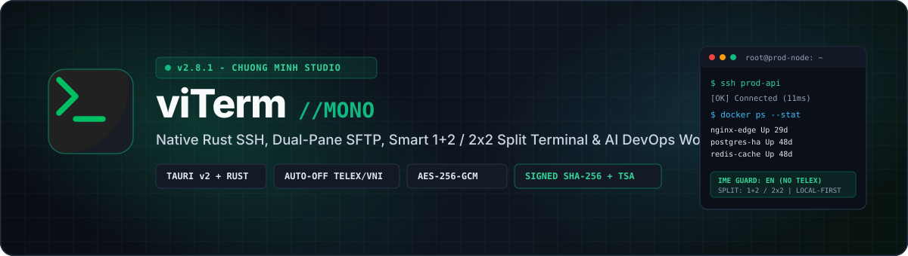

<div align="center">
  

  <br />

  <p>
    <a href="https://github.com/chuongminhofficial/viTerm/releases/latest">
      
    </a>
    
    
    
    
  </p>

  <p>
    <strong>Trình quản trị hạ tầng SSH, Dual-Pane SFTP, Terminal chia khung thông minh (1x1 / 1x2 / 1+2 / 2x2), Server Control Center &amp; AI DevOps Workspace</strong><br />
    <em>Thiết kế Casa Engine Square Mono | Hiệu năng Native Rust | Phát triển bởi <strong>Chuong Minh Studio</strong></em>
  </p>

  <p>
    <a href="#tai-xuong--cai-dat-v281"><b>Tải xuống v2.8.1</b></a> |
    <a href="INSTALLER_PARAMETERS.md"><b>Installer Parameters &amp; Return Codes</b></a> |
    <a href="#tinh-nang-cot-loi"><b>Tính năng</b></a> |
    <a href="#chu-ky-so--kiem-chung-toan-ven"><b>Chữ ký số &amp; SHA-256</b></a> |
    <a href="#english-summary"><b>English</b></a>
  </p>
</div>

---

> **Official Public Release & Showcase Repository**  
> Kho lưu trữ này là kênh phát hành chính thức các gói cài đặt đã biên dịch và ký số (`.exe`, `.msi`), chứng chỉ công khai (`.cer`), bảng mã băm `SHA256SUMS.txt`, tài liệu tham số cài đặt [`INSTALLER_PARAMETERS.md`](INSTALLER_PARAMETERS.md) và tiếp nhận báo lỗi (Issues). Mã nguồn gốc được lưu giữ riêng tư tại `chuongminhofficial/viTerm-source`.

---

## Tải xuống & Cài đặt (v2.8.1)

<div align="center">
  <a href="https://github.com/chuongminhofficial/viTerm/releases/tag/v2.8.1">
    
  </a>
  &nbsp;
  <a href="https://github.com/chuongminhofficial/viTerm/releases">
    
  </a>
</div>

<br />

Toàn bộ bộ cài đặt Windows x64 v2.8.1 bên dưới đã được biên dịch trực tiếp, kiểm định tự động chế độ cài đặt Silent (chuẩn **Microsoft Store Policy 10.2.9.2**) và ký số **Authenticode SHA-256** bởi **Chuong Minh Studio** kèm dấu thời gian **DigiCert RFC3161**:

| Gói phát hành | Định dạng & Dung lượng | Đặc điểm & Chữ ký số | Link Raw / Trực tiếp |
| :--- | :---: | :--- | :--- |
| [`viTerm_2.8.1_x64-store-setup.exe`](https://github.com/chuongminhofficial/viTerm/releases/download/v2.8.1/viTerm_2.8.1_x64-store-setup.exe) | Store Silent (~3.13 MB) | **Chuẩn Microsoft Store (`SilentInstall silent`)**, không hộp thoại, không cần switch, đầy đủ mã lỗi Win32 | [`Direct Raw`](https://raw.githubusercontent.com/chuongminhofficial/viTerm/main/releases/v2.8.1/viTerm_2.8.1_x64-store-setup.exe) |
| [`viTerm_2.8.1_x64-store-offline-setup.exe`](https://github.com/chuongminhofficial/viTerm/releases/download/v2.8.1/viTerm_2.8.1_x64-store-offline-setup.exe) | Store Offline (~287.33 MB) | **Chuẩn Microsoft Store (`SilentInstall silent`)**, nhúng sẵn WebView2 Offline Runtime | [`Release CDN`](https://github.com/chuongminhofficial/viTerm/releases/download/v2.8.1/viTerm_2.8.1_x64-store-offline-setup.exe) |
| [`viTerm_2.8.1_x64-setup.exe`](https://github.com/chuongminhofficial/viTerm/releases/download/v2.8.1/viTerm_2.8.1_x64-setup.exe) | NSIS Offline (~287.31 MB) | Nhúng sẵn WebView2 Offline Installer, giao diện cài đặt đầy đủ + hỗ trợ `/S` | [`Release CDN`](https://github.com/chuongminhofficial/viTerm/releases/download/v2.8.1/viTerm_2.8.1_x64-setup.exe) |
| [`viTerm_2.8.1_x64-setup-light.exe`](https://github.com/chuongminhofficial/viTerm/releases/download/v2.8.1/viTerm_2.8.1_x64-setup-light.exe) | NSIS Light (~4.78 MB) | Bộ cài siêu nhẹ cho người dùng phổ thông (hỗ trợ cả GUI và `/S` không chặn hộp thoại) | [`Direct Raw`](https://raw.githubusercontent.com/chuongminhofficial/viTerm/main/releases/v2.8.1/viTerm_2.8.1_x64-setup-light.exe) |
| [`viTerm_2.8.1_x64_en-US.msi`](https://github.com/chuongminhofficial/viTerm/releases/download/v2.8.1/viTerm_2.8.1_x64_en-US.msi) | Windows MSI (~5.43 MB) | Gói cài đặt chuẩn Microsoft Windows Installer (WiX), triển khai GPO / Silent `/qn` | [`Direct Raw`](https://raw.githubusercontent.com/chuongminhofficial/viTerm/main/releases/v2.8.1/viTerm_2.8.1_x64_en-US.msi) |
| [`viTerm_2.8.1_x64-portable.exe`](https://github.com/chuongminhofficial/viTerm/releases/download/v2.8.1/viTerm_2.8.1_x64-portable.exe) | Portable SFX (~3.01 MB) | Chạy trực tiếp không cần cài đặt (yêu cầu WebView2 Runtime trên máy) | [`Release CDN`](https://github.com/chuongminhofficial/viTerm/releases/download/v2.8.1/viTerm_2.8.1_x64-portable.exe) |
| [`viterm.exe`](https://github.com/chuongminhofficial/viTerm/releases/download/v2.8.1/viterm.exe) | Standalone PE (~5.40 MB) | File thực thi độc lập đã ký số `Chuong Minh Studio` | [`Release CDN`](https://github.com/chuongminhofficial/viTerm/releases/download/v2.8.1/viterm.exe) |
| [`SHA256SUMS.txt`](https://github.com/chuongminhofficial/viTerm/releases/download/v2.8.1/SHA256SUMS.txt) | Checksum | Danh sách mã băm SHA-256 đối chiếu toàn bộ tệp phát hành | [`Direct Raw`](https://raw.githubusercontent.com/chuongminhofficial/viTerm/main/releases/v2.8.1/SHA256SUMS.txt) |

> Ghi chú nền tảng: Phiên bản `v2.8.1` cung cấp đầy đủ các định dạng phát hành cho **Windows x64** (bao gồm bản chuyên biệt cho Microsoft Store Partner Center). Các bản cài cho macOS và Linux từ bản trước vẫn có thể tải tại trang [Releases](https://github.com/chuongminhofficial/viTerm/releases).

---

## Điểm nâng cấp lớn trong v2.8.0

| Hạng mục | Cải tiến kỹ thuật chi tiết |
| :--- | :--- |
| **Khắc phục triệt để lỗi Thu nhỏ (Minimize) Windows** | Tích hợp Win32 FFI **Work-Area Fit** (`MONITORINFO.rc_work` + `WS_MINIMIZEBOX / WS_SYSMENU`) cho cửa sổ không viền, giúp thu nhỏ và bấm Taskbar mở lại ổn định 100%, không bị treo hay mất cửa sổ. |
| **Tự động vô hiệu hóa Telex / VNI trong Terminal** | Cơ chế bảo vệ **2 lớp**: Win32 `ImmAssociateContextEx` + tự động chuyển Keyboard Layout sang `EN` khi focus khung Terminal kết hợp bộ giải mã ASCII thời gian thực chặn bộ gõ ngoài (UniKey/EVKey). Gõ `clear`, `free`, `ufw`, `root`, `dd`, `awk` chính xác tuyệt đối. Có nút bật/tắt nhanh `EN · Tắt Telex/VNI` ngay trên thanh lệnh. |
| **Local-First & Ghi nhớ Theme/Ngôn ngữ vĩnh viễn** | Ưu tiên Tauri Persistent Store (`viterm_data.json`), giữ cố định chế độ Sáng/Tối và Ngôn ngữ qua mọi lần khởi động. Toàn bộ cấu hình và danh sách máy chủ lưu cục bộ 100%; chỉ tự động kéo Cloud Sync khi đăng nhập lần đầu trên máy mới. |
| **Chia khung thông minh (`1x1`, `1x2`, `1+2`, `2x2`)** | Bổ sung bố cục **3 khung (`1+2`)**, nút `+` thêm khung tự động kết nối và nút `-` / `x` đóng chính xác từng khung riêng lẻ mà giữ nguyên toàn bộ phiên SSH/Shell đang chạy ở các khung còn lại. |
| **Chuẩn xác 100% giao diện RTL (Tiếng Ả Rập)** | Sửa triệt để lỗi dư khoảng trống 216px lộ phần tử phía sau khi mở Terminal ở chế độ `dir="rtl"`, tự động căn phải Sidebar/Dock và giữ lưới ký tự `xterm.js` căn trái chuẩn xác. |
| **Hiệu năng & Bảo mật cấp hệ thống** | Bật **Content Security Policy (CSP)**, gia cố chống SSH Option Injection, dọn sạch 100% tiến trình ngầm và ghi đè `0x00` xóa khóa tạm khi thoát, cắt giảm hơn 55% dung lượng CSS và hơn 15 MB font thừa. |

---

## Tính năng cốt lõi

### 1. Multi-Tab & Smart Split-View Terminal (`xterm.js` 60fps)
- **Đa Tab + Đa khung**: Mở không giới hạn số Tab; mỗi Tab chia tối đa 4 khung (`1x1`, `1x2`, `1+2`, `2x2`) chạy đồng thời SSH VPS, Windows PowerShell, CMD hoặc Bash/WSL.
- **Native `SSH_ASKPASS` nội bộ**: Tự động xác thực Password/Passphrase và xử lý xung đột `known_hosts` ngầm, không bật cửa sổ CMD đen, không bị màn hình Terminal trống.
- **Broadcast Input & Smart Command Bar**: Gõ lệnh đồng loạt trên nhiều máy chủ; thanh nhập lệnh thông minh cố định ở đáy kèm nút nhảy nhanh đầu/cuối trang và chế độ `TUI Fit`.
- **Smart Link (`Ctrl + Click`) & Right-Click Memory**: Tự động nhận diện URL/IP trong Terminal và ghi nhớ thao tác chuột phải Copy/Paste.

### 2. Server Control Center (Quản trị Máy chủ Toàn diện)
- Giám sát thời gian thực từ máy chủ thật (không giả lập): **CPU Load, RAM, Disk (`df -hT`), Network Interfaces (`/proc/net/dev`), Listening Ports (`ss -tulpn`)**.
- **Process Manager**: Lọc tiến trình, gửi `SIGTERM (-15)` hoặc `SIGKILL (-9)` trực tiếp.
- **Systemd Services & Docker Studio**: Start/Stop/Restart/Reload dịch vụ, xem `journalctl` / `docker logs`, mở shell container và dọn cache Docker.
- **Firewall UFW, Fail2ban & Cronjobs**: Thêm/chặn cổng UFW, rà soát IP Brute-force SSH và quản lý Crontab trực quan.

### 3. Dual-Pane SFTP Studio & Live Code Editor
- Kéo và thả 2 chiều giữa **Local Machine <-> Remote Server** (và kéo trực tiếp từ Windows Explorer) với thanh tiến trình thời gian thực.
- **Live Code Editor (Auto-Save)**: Sửa tệp cấu hình/mã nguồn trực tiếp trên máy chủ, tự động đồng bộ khi ngừng gõ và dọn sạch bản tạm cục bộ.
- Giải nén trực tiếp (`.zip`, `.tar.gz`, `.tgz`, `.tar.bz2`, `.tar.xz`) và đổi tên ngay trên giao diện.


### 4. AI Terminal Copilot & Thông báo Đa kênh
- Kết nối trực tiếp **Ollama Local** (miễn phí), **Gemini**, **OpenAI**, **OpenRouter**, **Groq**, **DeepSeek**, **LM Studio**, **vLLM**, và **Claude** với bộ quét Model tự động.
- **Safe-Guard** cảnh báo lệnh nguy hiểm (`rm -rf`, `mkfs`, `reboot`) và đẩy cảnh báo vận hành tức thì về **Telegram Bot**, **Zalo Bot**, **Slack**, **Discord**.


---

## Chữ ký số & Kiểm chứng toàn vẹn

Toàn bộ các gói cài đặt và tệp thực thi Windows của **viTerm v2.8.1** đều được ký số chuẩn **Authenticode SHA-256** kèm dấu thời gian **DigiCert RFC3161**:

| Thuộc tính | Giá trị xác thực |
| :--- | :--- |
| **Signer Subject** | `CN=Chuong Minh Studio, O=Chuong Minh Studio, C=VN` |
| **Thuật toán** | `RSA-3072 / SHA-256` + `DigiCert SHA256 RSA4096 Timestamp` |
| **Certificate Thumbprint** | `63F0FAF511CD33F8CC7453E6FBC0F20D9126B875` |
| **Microsoft Store Silent Mode** | `SilentInstall silent` (`store-silent-hooks.nsh`), Zero-UI, đầy đủ mã trả về Win32 tiêu chuẩn ([`INSTALLER_PARAMETERS.md`](INSTALLER_PARAMETERS.md)) |

### Bảng mã băm SHA-256 chính thức (`v2.8.1`)

```text
40100C9B59441AA0C76D4AF4DF5352FF2429FEC28C76ABA8F97C4E24A26E0491  viTerm_2.8.1_x64-store-setup.exe
2D65FB3C7CA6EE8C7C06EC6A08D15A454CCB3344EAE62974177A91425AB958C1  viTerm_2.8.1_x64-store-offline-setup.exe
7EB9602B201D18358A78A52FDD7D299E1187F5C71ED55B163A13DC54B9E4C7A3  viTerm_2.8.1_x64-setup.exe
6D15663758BBA6AE5D6CFB38687D96C5A679F2A3E1132A68316208D83C07404F  viTerm_2.8.1_x64-setup-light.exe
E7836E11F31C8646AFEC9F435594A3F891C286D9A2A9C4FA62D6D30CB4BB9963  viTerm_2.8.1_x64_en-US.msi
466977340A8ECDB5352BE499497D216FEB46B49F8DB143659232406AB2DCB4BB  viTerm_2.8.1_x64-portable.exe
C98CB9E7F3E09F08A93A71586672D91614B5B47E6564E8B6DA1EAD37209B5226  viterm.exe
F8E67BFE4DC98A53DA55D741AE5B0A9C896AA62262E3FA477EAA7E7EE6E75DBD  ChuongMinhStudio-CodeSigning.cer
```

### Lệnh kiểm tra trên Windows PowerShell

```powershell
Get-FileHash -Algorithm SHA256 .\viTerm_2.8.1_x64-store-setup.exe
Get-AuthenticodeSignature .\viTerm_2.8.1_x64-store-setup.exe | Format-List Status, SignerCertificate, TimeStamperCertificate
```

---

## English Summary

**viTerm v2.8.1** (*Chuong Minh Studio & Microsoft Store Silent Edition*) is a high-performance **SSH, Dual-Pane SFTP, Smart Split-View Terminal, Server Control Center & AI DevOps Workspace** built on **Tauri v2 (Rust)** and **xterm.js**.

- **Microsoft Store Policy 10.2.9.2 Compliant**: Dedicated Store Silent installers (`viTerm_2.8.1_x64-store-setup.exe` & `viTerm_2.8.1_x64-store-offline-setup.exe`) run 100% silently with zero UI dialogs, zero switch requirements, and deterministic Win32 return codes documented in [`INSTALLER_PARAMETERS.md`](INSTALLER_PARAMETERS.md).
- **Zero-Glitch Windows UX**: Native Win32 Work-Area Fit for borderless windows ensures reliable taskbar minimize/restore on Windows 10/11.
- **Automatic Terminal IME / Telex / VNI Guard**: Dual-layer native Win32 IME suppression + real-time ASCII reconstruction prevents Vietnamese Telex/VNI input methods from corrupting shell commands.
- **Local-First Architecture**: Instant startup with persistent local theme/language/vault storage (`AES-256-GCM`); cloud sync automatically triggers only on new devices.
- **Smart Split Panes (`1x1`, `1x2`, `1+2`, `2x2`) & Full RTL Support**: Add or close individual panes smoothly without interrupting sibling sessions, with pixel-accurate Arabic RTL layout.

---

<div align="center">
  <p>Developed by <strong>Chuong Minh Studio</strong> | <a href="INSTALLER_PARAMETERS.md">Installer Parameters</a> | <a href="CHANGELOG.md">Changelog</a> | <a href="SECURITY.md">Security Policy</a> | <a href="https://github.com/chuongminhofficial/viTerm/issues">Report an Issue</a></p>
</div>
