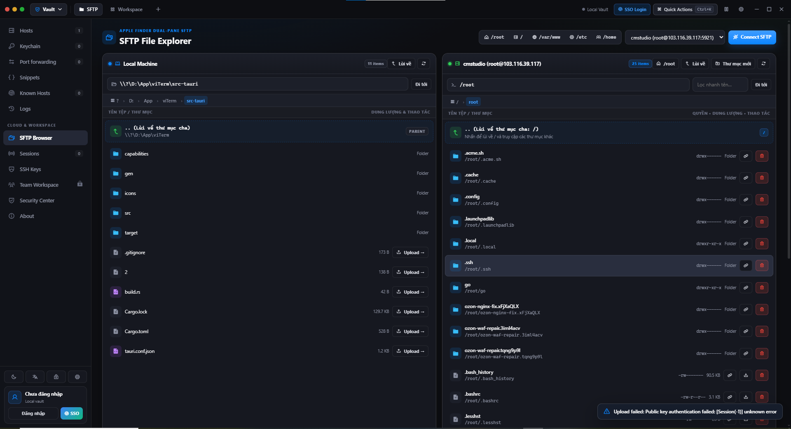
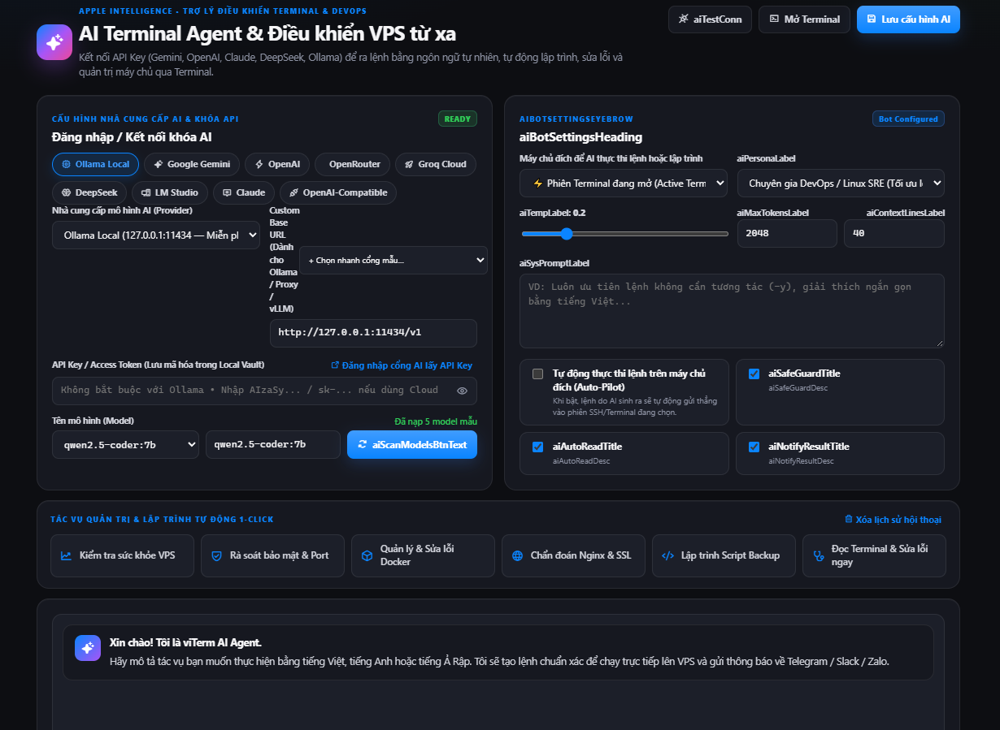

<div align="center">
  

  <br />

  <p>
    <a href="https://github.com/chuongminhofficial/viTerm/releases/latest">
      
    </a>
    
    
    
    
  </p>

  <p>
    <strong>Trình quản trị hạ tầng SSH, Dual-Pane SFTP, Terminal Chia khung thông minh (1×1 / 1×2 / 1+2 / 2×2), Server Control Center &amp; AI DevOps Workspace</strong><br />
    <em>Thiết kế chuẩn công nghiệp Casa Engine Square Mono • Hiệu năng Native Rust • Phát triển bởi <strong>Chuong Minh Studio</strong></em>
  </p>

  <p>
    <a href="#-tải-xuống--cài-đặt-v280"><b>📦 Tải xuống v2.8.0</b></a> •
    <a href="#-điểm-nâng-cấp-lớn-trong-v280"><b>🚀 Có gì mới</b></a> •
    <a href="#-tính-năng-cốt-lõi"><b>⚡ Tính năng</b></a> •
    <a href="#-chữ-ký-số--kiểm-chứng-toàn-vẹn"><b>🔐 Chữ ký số &amp; SHA-256</b></a> •
    <a href="#-english-summary"><b>🌐 English</b></a>
  </p>
</div>

---

> **Official Public Release & Showcase Repository**  
> Kho lưu trữ này là kênh phát hành chính thức các gói cài đặt đã biên dịch (`.exe`, `.dmg`, `.zip`, `.AppImage`, `.deb`), chứng chỉ công khai, mã băm kiểm chứng `SHA256SUMS.txt`, tài liệu kỹ thuật và tiếp nhận báo lỗi (Issues). Mã nguồn gốc được lưu giữ riêng tư tại `chuongminhofficial/viTerm-source` và tự động đóng gói đa nền tảng qua GitHub Actions.

---

## 📦 Tải xuống & Cài đặt (v2.8.0)

<div align="center">
  <a href="https://github.com/chuongminhofficial/viTerm/releases/tag/v2.8.0">
    
  </a>
  &nbsp;
  <a href="https://github.com/chuongminhofficial/viTerm/releases">
    
  </a>
</div>

<br />

| Hệ điều hành | Gói phát hành | Đặc điểm & Chữ ký số | Khuyên dùng |
| :--- | :--- | :--- | :---: |
| **Windows 10/11 (x64)** | `viTerm_2.8.0_x64-setup.exe` *(Offline Full)* | Nhúng sẵn WebView2 Offline Installer • **Đã ký số `Chuong Minh Studio` + DigiCert Timestamp** | ⭐ Khuyên dùng (VM / Offline) |
| **Windows 10/11 (x64)** | `viTerm_2.8.0_x64-setup-light.exe` *(~4.8 MB)* | Bộ cài siêu nhẹ dùng WebView2 Bootstrapper • **Đã ký số `Chuong Minh Studio` + DigiCert Timestamp** | ⚡ Tải nhanh |
| **Windows 10/11 (x64)** | `viterm.exe` *(~5.4 MB Standalone)* | File thực thi trực tiếp đã ký số `Chuong Minh Studio` | 🧰 Portable |
| **macOS Apple Silicon** | `viTerm-macOS-2.8.0-arm64.dmg` / `.zip` | Build native `aarch64-apple-darwin` qua GitHub Actions | 🍎 M1 / M2 / M3 / M4 |
| **macOS Intel** | `viTerm-macOS-2.8.0-x64.dmg` / `.zip` | Build native `x86_64-apple-darwin` qua GitHub Actions | 💻 Intel Mac |
| **Linux (x64)** | `viTerm-Linux-2.8.0-x64.AppImage` / `.deb` | Build native `x86_64-unknown-linux-gnu` (Ubuntu/Debian/Arch/Fedora) | 🐧 Linux |
| **Chứng chỉ & Checksum** | `ChuongMinhStudio-CodeSigning.cer`, `SHA256SUMS.txt` | Chứng chỉ công khai RSA-3072 & mã băm SHA-256 đối chiếu | 🔐 Xác thực |

---

## 🚀 Điểm nâng cấp lớn trong v2.8.0

| Hạng mục | Cải tiến kỹ thuật chi tiết |
| :--- | :--- |
| **🪟 Sửa triệt để lỗi Thu nhỏ (Minimize) Windows** | Tích hợp Win32 FFI **Work-Area Fit** (`MONITORINFO.rc_work` + `WS_MINIMIZEBOX / WS_SYSMENU`) cho cửa sổ không viền, giúp thu nhỏ và bấm Taskbar mở lại mượt mà 100% không bao giờ bị kẹt. |
| **⌨️ Tự động vô hiệu hóa Telex / VNI trong Terminal** | Cơ chế bảo vệ **2 lớp** (Win32 `ImmAssociateContextEx` + tự động chuyển Keyboard Layout sang `EN` khi focus Terminal kết hợp bộ giải mã ASCII thời gian thực chặn cả UniKey/EVKey ngoài). Gõ `clear`, `free`, `ufw`, `root`, `dd`, `awk` chuẩn xác tuyệt đối. Có nút bật/tắt nhanh `EN · Tắt Telex/VNI` ngay trên thanh lệnh. |
| **💾 Local-First & Ghi nhớ Theme/Ngôn ngữ vĩnh viễn** | Ưu tiên Tauri Persistent Store (`viterm_data.json`), giữ cố định chế độ Sáng/Tối và Ngôn ngữ qua mọi lần khởi động. Toàn bộ cấu hình & máy chủ lưu cục bộ 100%; chỉ tự động kéo Cloud Sync khi đăng nhập lần đầu trên máy mới. |
| **🧩 Chia khung thông minh (`1×1`, `1×2`, `1+2`, `2×2`)** | Thêm bố cục **3 khung (`1+2`)**, nút `+` thêm khung tự động kết nối, và nút `−` / `×` đóng chính xác từng khung riêng lẻ mà **giữ nguyên toàn bộ phiên SSH/Shell** đang chạy ở các khung còn lại kèm hiệu ứng mượt mà. |
| **🌍 Chuẩn xác 100% giao diện RTL (Tiếng Ả Rập)** | Sửa triệt để lỗi hở khoảng trống 216px khi mở Terminal ở chế độ `dir="rtl"`, tự động căn phải Sidebar/Dock và giữ lưới ký tự `xterm.js` căn trái chuẩn xác. |
| **⚡ Hiệu năng & Bảo mật cấp hệ thống** | Bật **Content Security Policy (CSP)**, gia cố chống SSH Option Injection, dọn dẹp 100% tiến trình ngầm và ghi đè `0x00` xóa khóa tạm khi thoát, cắt giảm >55% dung lượng CSS và >15MB font thừa. |

---

## ⚡ Tính năng cốt lõi

### 1. 🖥 Multi-Tab & Smart Split-View Terminal (`xterm.js` 60fps)
- **Đa Tab + Đa khung**: Mở không giới hạn số Tab; mỗi Tab chia tối đa 4 khung (`1×1`, `1×2`, `1+2`, `2×2`) chạy đồng thời SSH VPS, Windows PowerShell, CMD hoặc Bash/WSL.
- **Native `SSH_ASKPASS` nội bộ**: Tự động xác thực Password/Passphrase và dọn xung đột `known_hosts` ngầm, không bật cửa sổ CMD đen, không bị màn hình Terminal trống.
- **Broadcast Input & Smart Command Bar**: Gõ lệnh đồng loạt trên nhiều máy chủ; thanh nhập lệnh thông minh luôn cố định ở đáy kèm nút nhảy nhanh đầu/cuối trang và chế độ `TUI Fit`.
- **Smart Link (`Ctrl + Click`) & Right-Click Memory**: Tự động nhận diện URL/IP trong luồng log Terminal và ghi nhớ thao tác chuột phải Copy/Paste.

### 2. 📊 Server Control Center (Quản trị Máy chủ Toàn diện)
- Giám sát thời gian thực từ máy chủ thật (không giả lập): **CPU Load, RAM, Disk (`df -hT`), Network Interfaces (`/proc/net/dev`), Listening Ports (`ss -tulpn`)**.
- **Process Manager**: Lọc tiến trình, gửi `SIGTERM (-15)` hoặc `SIGKILL (-9)` 1-Click.
- **Systemd Services & Docker Studio**: Start/Stop/Restart/Reload dịch vụ, xem `journalctl` / `docker logs`, mở shell container và dọn cache Docker.
- **Firewall UFW, Fail2ban & Cronjobs**: Thêm/chặn cổng UFW, rà soát IP Brute-force SSH và quản lý Crontab trực quan.

### 3. 📂 Dual-Pane SFTP Studio & Live Code Editor
- Kéo & thả 2 chiều giữa **Local Machine ↔ Remote Server** (và kéo trực tiếp từ Windows Explorer) với thanh tiến trình thời gian thực.
- **Live Code Editor (Auto-Save)**: Sửa file cấu hình/code trực tiếp trên server, tự động đồng bộ khi ngừng gõ và dọn sạch bản tạm cục bộ.
- Giải nén 1-Click (`.zip`, `.tar.gz`, `.tgz`, `.tar.bz2`, `.tar.xz`) và đổi tên ngay trên giao diện.



### 4. 🤖 AI Terminal Copilot & Thông báo Đa kênh
- Kết nối trực tiếp **Ollama Local** (miễn phí), **Gemini**, **OpenAI**, **OpenRouter**, **Groq**, **DeepSeek**, **LM Studio**, **vLLM**, và **Claude** với bộ quét Model 1-Click.
- **Safe-Guard** cảnh báo lệnh nguy hiểm (`rm -rf`, `mkfs`, `reboot`) và đẩy cảnh báo vận hành tức thì về **Telegram Bot**, **Zalo Bot**, **Slack**, **Discord**.



---

## 🔐 Chữ ký số & Kiểm chứng toàn vẹn

Các tệp phát hành Windows của **viTerm v2.8.0** được ký số chuẩn **Authenticode SHA-256** kèm dấu thời gian **DigiCert RFC3161**:

| Thuộc tính | Giá trị xác thực |
| :--- | :--- |
| **Signer Subject** | `CN=Chuong Minh Studio, O=Chuong Minh Studio, C=VN` |
| **Thuật toán** | `RSA-3072 / SHA-256` + `DigiCert SHA256 RSA4096 Timestamp` |
| **Certificate Thumbprint** | `C189966102B56902F723943D0EA49E76B421D201` |
| **NSIS Trust Hook** | Tự động cài đặt chứng chỉ công khai vào `CurrentUser\Root` & `CurrentUser\TrustedPublisher` (tự gỡ sạch khi Uninstall) |

### Kiểm chứng mã băm SHA-256 trên Windows PowerShell
```powershell
Get-FileHash -Algorithm SHA256 .\viTerm_2.8.0_x64-setup.exe
Get-AuthenticodeSignature .\viTerm_2.8.0_x64-setup.exe | Format-List Status, SignerCertificate, TimeStamperCertificate
```

---

## 🌐 English Summary

**viTerm v2.8.0** (*Chuong Minh Studio Edition*) is a high-performance **SSH, Dual-Pane SFTP, Smart Split-View Terminal, Server Control Center & AI DevOps Workspace** built on **Tauri v2 (Rust)** and **xterm.js**.

- **Zero-Glitch Windows UX**: Native Win32 Work-Area Fit for borderless windows ensures reliable taskbar minimize/restore on Windows 10/11.
- **Automatic Terminal IME / Telex / VNI Guard**: Dual-layer native Win32 IME suppression + real-time ASCII reconstruction prevents Vietnamese Telex/VNI input methods from corrupting shell commands.
- **Local-First Architecture**: Instant startup with persistent local theme/language/vault storage (`AES-256-GCM`); cloud sync automatically triggers only on new devices.
- **Smart Split Panes (`1×1`, `1×2`, `1+2`, `2×2`) & Full RTL Support**: Add or close individual panes smoothly without interrupting sibling sessions, with pixel-accurate Arabic RTL layout.
- **Signed Releases**: Windows installers and standalone binaries are Authenticode-signed by **Chuong Minh Studio** with DigiCert RFC3161 timestamps, alongside automated GitHub Actions builds for **macOS (Apple Silicon & Intel)** and **Linux (AppImage & DEB)**.

---

<div align="center">
  <p>Crafted with precision by <strong>Chuong Minh Studio</strong> • <a href="CHANGELOG.md">Changelog</a> • <a href="SECURITY.md">Security Policy</a> • <a href="https://github.com/chuongminhofficial/viTerm/issues">Report an Issue</a></p>
</div>
